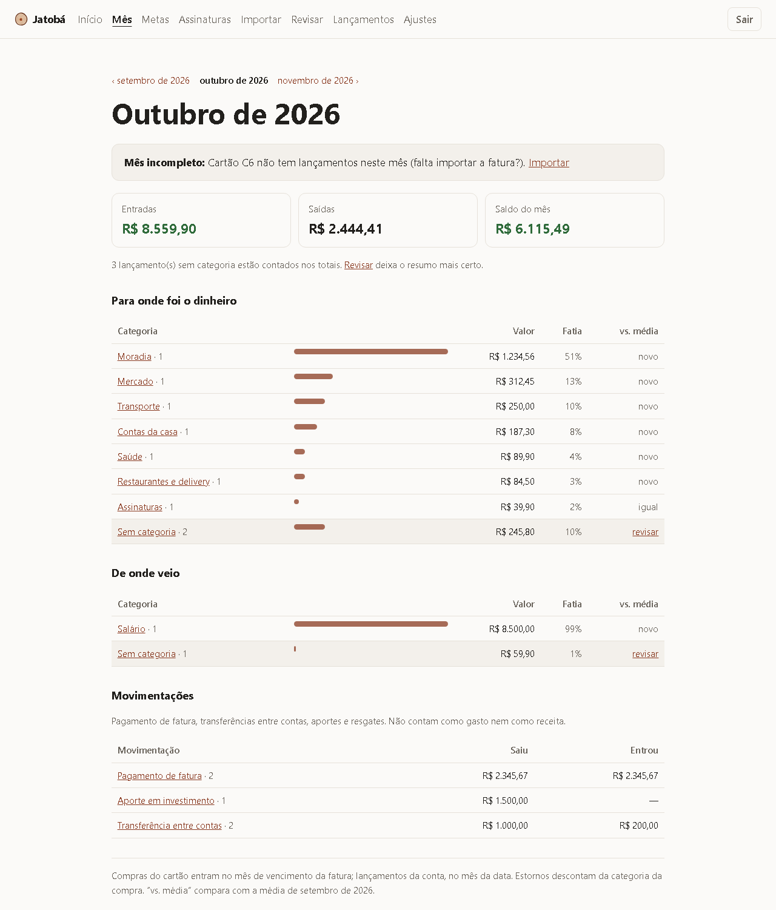
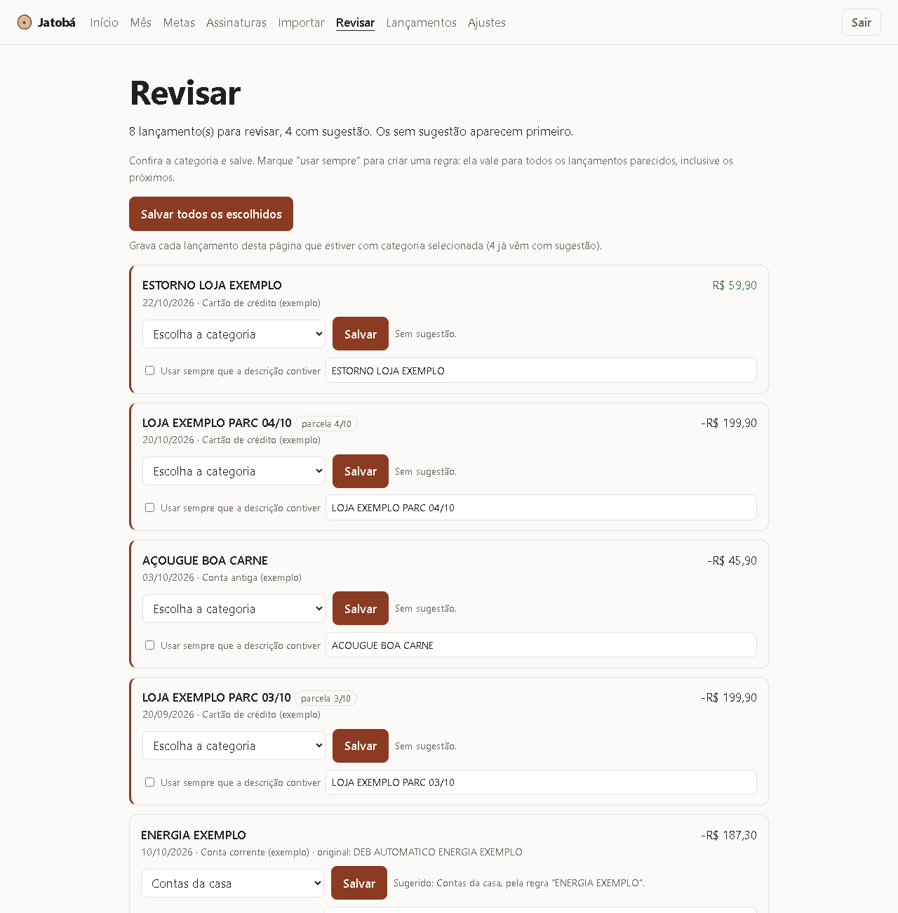
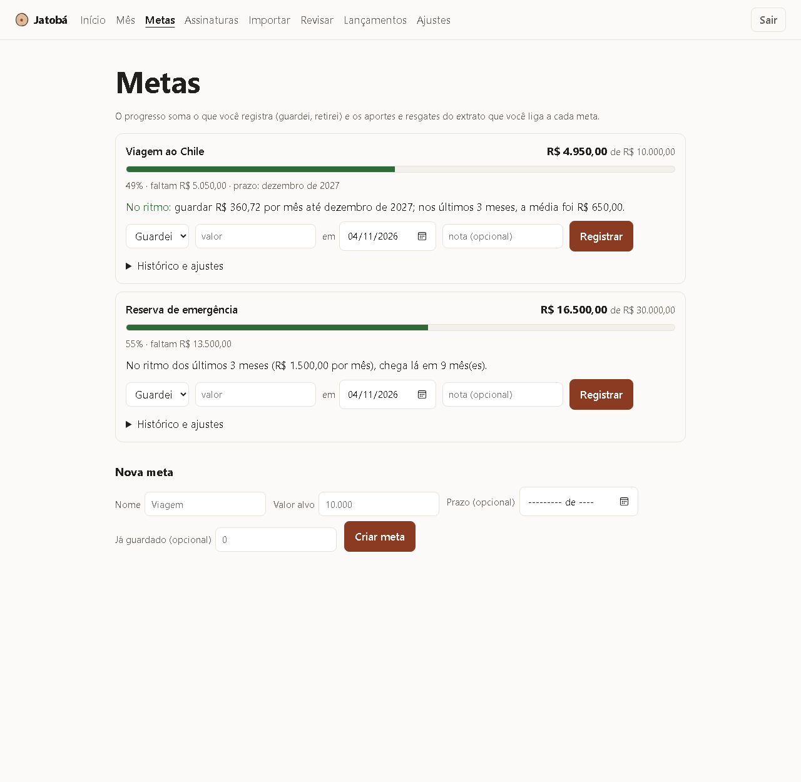
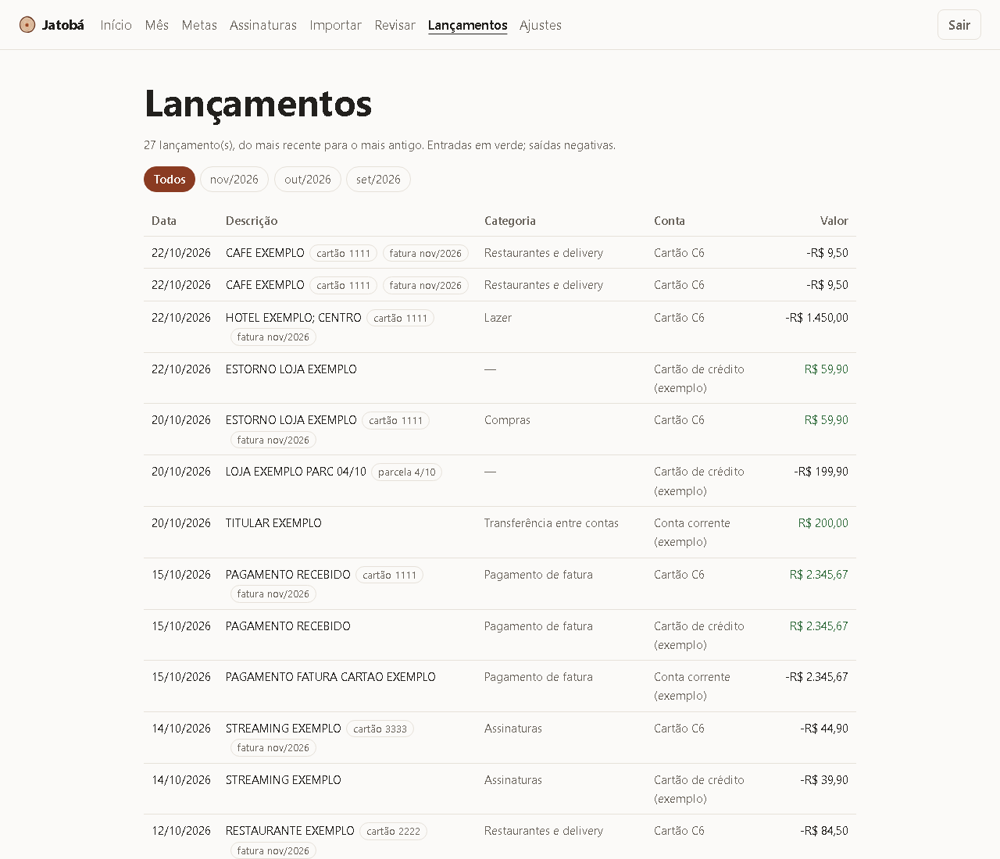
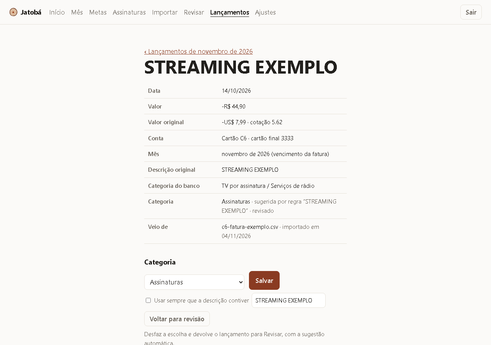
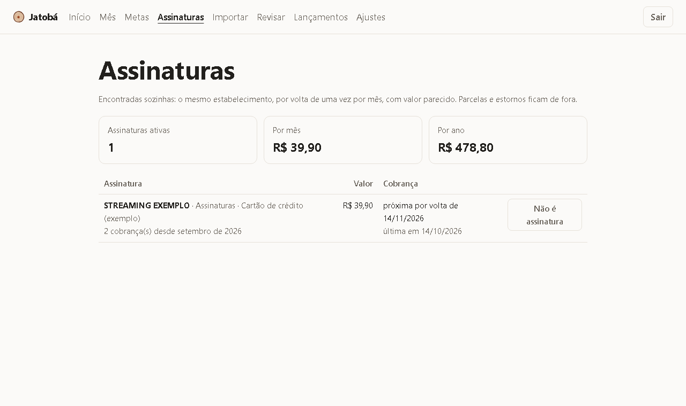
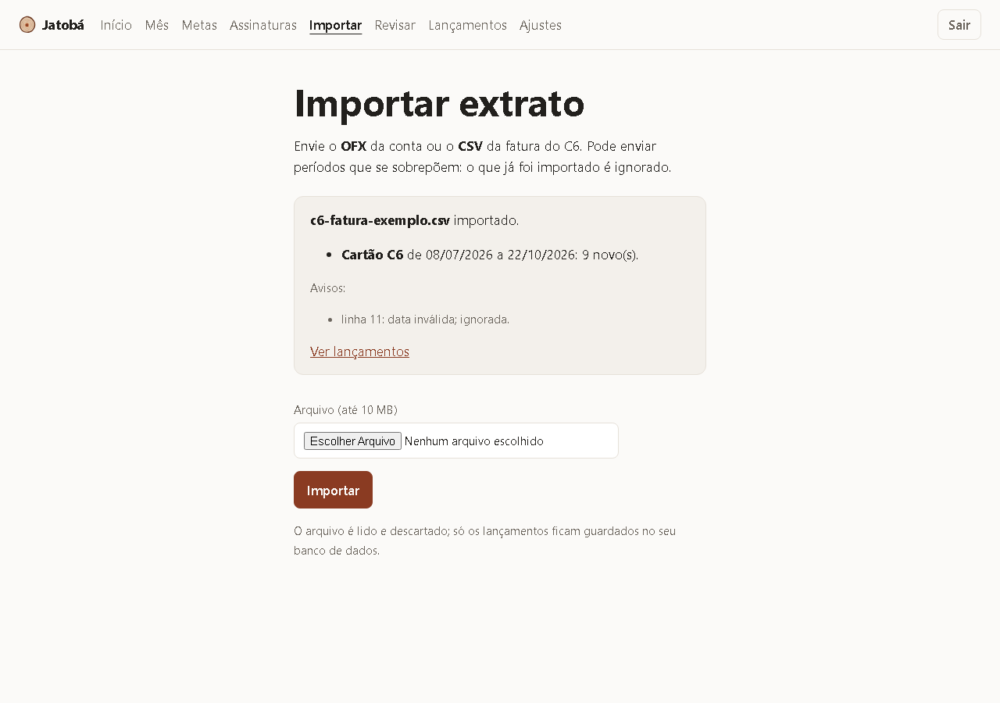
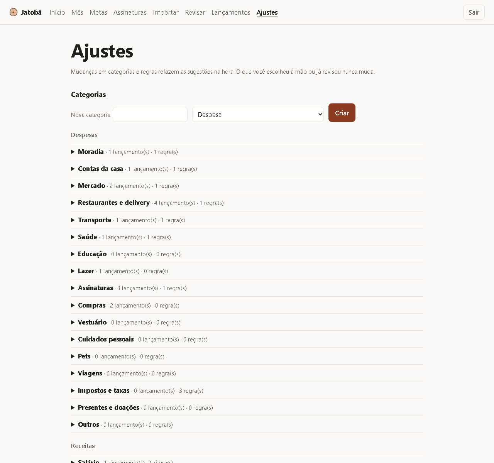
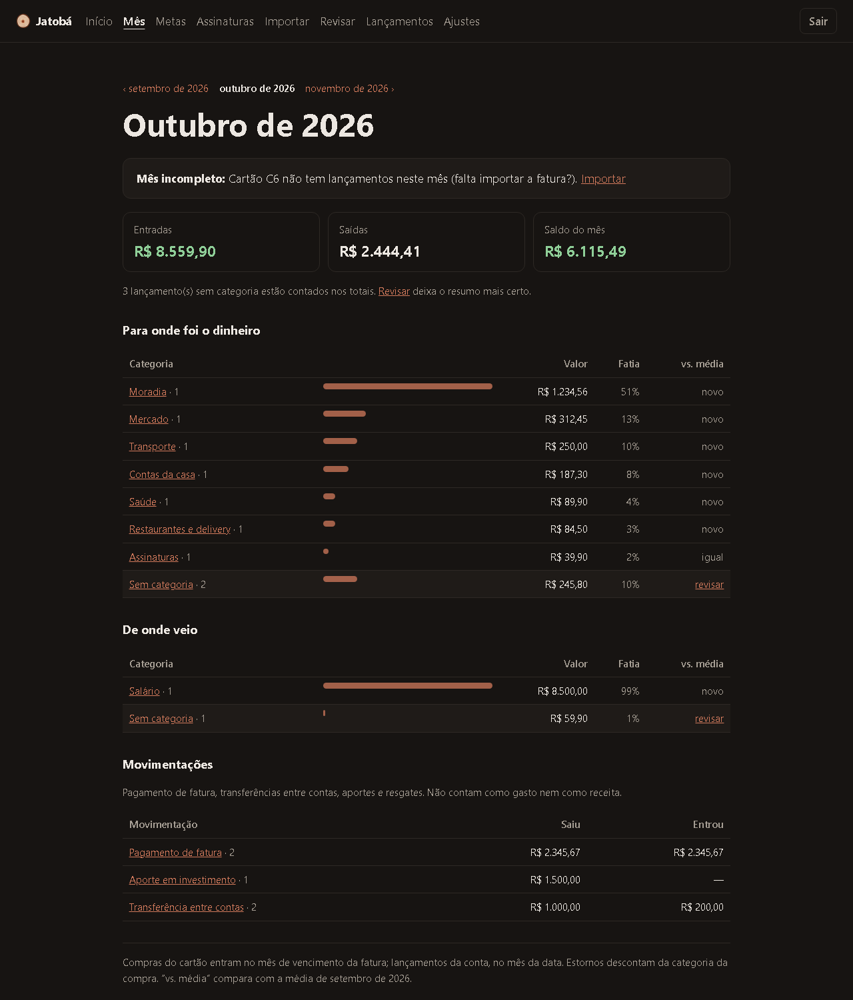

<p align="center">
  <picture>
    <source media="(prefers-color-scheme: dark)" srcset="docs/img/logo-escuro.svg">
    
  </picture>
</p>

<p align="center"><b>Every resource has a purpose.</b></p>

Finanças pessoais no seu próprio computador ou servidor. O Jatobá importa os extratos do banco, organiza os gastos por categoria, encontra assinaturas e acompanha suas metas, como a reserva de emergência, a entrada de um imóvel ou uma viagem. Seus dados ficam com você: nada de senha de banco, nada de nuvem de terceiros.

> **Em desenvolvimento.** Antes da versão 1.0 pode haver mudanças incompatíveis. Veja o [roadmap](docs/roadmap.md).

## Por que Jatobá

O **jatobá** é uma árvore brasileira de vida longa e de madeira das mais duras que existem, usada no que precisa durar. O nome remete a isso: **longevidade** e **a construção de algo sólido**, que é o que se faz com dinheiro bem cuidado, um mês depois do outro.

O logo é o corte do tronco de um jatobá. Os **anéis de crescimento** contam os anos, como os meses que vão se acumulando no Jatobá. No centro fica o **cerne**, a parte mais dura e mais firme da madeira, a base sobre a qual o resto cresce. É a cor que aparece em toda a interface.

O lema, *every resource has a purpose* (todo recurso tem um propósito), resume a ideia: saber para onde vai cada real e para que ele está sendo guardado.

## Telas

As imagens abaixo usam **dados fictícios**, os mesmos extratos de exemplo dos testes (`bash scripts/gerar-capturas.sh` gera tudo de novo).

**Mês**: entradas, saídas e saldo; para onde foi o dinheiro, por categoria, comparado com a média dos meses anteriores. Pagamento de fatura, transferências e investimentos ficam à parte e não contam como gasto.

<p align="center"></p>

<details>
<summary><b>Revisar</b>: confirme as categorias sugeridas, de uma em uma ou todas de uma vez</summary>

As sugestões vêm das suas regras, das regras do sistema, da categoria que o banco informa, do estorno de uma compra ou, se você ligar, da IA. Com “usar sempre”, uma escolha vira regra para os lançamentos parecidos.

<p align="center"></p>
</details>

<details>
<summary><b>Metas</b>: quanto já guardou, quanto falta e se está no ritmo</summary>

<p align="center"></p>
</details>

<details>
<summary><b>Lançamentos</b>: tudo o que foi importado, com filtro por mês e por categoria</summary>

<p align="center"></p>

Cada lançamento tem sua página, com todos os detalhes e a categoria editável a qualquer momento:

<p align="center"></p>
</details>

<details>
<summary><b>Assinaturas</b>: encontradas sozinhas, com total por mês e por ano</summary>

<p align="center"></p>
</details>

<details>
<summary><b>Importar</b> e <b>Ajustes</b></summary>

<p align="center"></p>
<p align="center"></p>
</details>

<details>
<summary>Tema escuro (automático, segue o sistema)</summary>

<p align="center"></p>
</details>

## O que ele faz (e o que não faz)

- **Importa** extratos OFX (conta e cartão, de qualquer banco) e o CSV da fatura do C6. Descarta duplicados, inclusive em períodos que se sobrepõem, e avisa quando algo parece repetido com texto diferente.
- **Categoriza** por regras que você aprova, pela categoria do banco e pelos estornos; com a IA ligada, sugere o resto. Nada vale sem a sua revisão.
- **Mostra** para onde foi o dinheiro no mês. Compras do cartão entram no mês de vencimento da fatura, e parcelas não se repetem.
- **Acompanha metas**, com o valor por mês necessário para chegar no prazo.
- **Encontra assinaturas** e avisa reajustes.
- **Faz backup** criptografado todo dia; só a sua chave privada, guardada fora do computador, abre os backups.
- **Bot do Telegram** e **IA** são opcionais e vêm desligados.
- **Não** se conecta ao seu banco, **não** faz pagamentos e **não** recomenda investimentos.

## Bot do Telegram

Opcional: consultas rápidas pelo celular e avisos. Ele só lê, só responde aos chats autorizados e não precisa expor o Jatobá na internet. Como ligar: [docs/telegram.md](docs/telegram.md).

| Comando | O que mostra |
| --- | --- |
| `/mes` | Entradas, saídas, saldo e os maiores gastos do mês mais recente |
| `/mes 10/2026` ou `/mes outubro` | O mesmo, de um mês escolhido |
| `/metas` | Quanto já foi guardado em cada meta e se está no ritmo |
| `/revisar` | Quantos lançamentos faltam revisar e possíveis duplicados |
| `/assinaturas` | Assinaturas ativas, total por mês, reajustes e próxima cobrança |
| `/backup` | Quando foi o último backup |
| `/ajuda` | A lista de comandos |

Avisos automáticos: quando uma importação termina (quantos novos e quantos para revisar) e quando o backup diário falha.

## Instalação

Você precisa do Docker: [Docker Desktop](https://docs.docker.com/desktop/) no Windows e no Mac, ou o Docker Engine no Linux. Roda em computadores Intel/AMD (amd64) e ARM (arm64), como Mac com chip Apple e Raspberry Pi 4 ou mais novo com sistema de 64 bits.

```bash
git clone https://github.com/rya112/jatoba-finance.git
cd jatoba-finance
cp .env.example .env
```

Edite o `.env` e preencha `JATOBA_ADMIN_USER`, `JATOBA_ADMIN_PASSWORD` (14 caracteres ou mais) e `POSTGRES_PASSWORD` (só letras e números; gere com `openssl rand -hex 24`). Depois:

```bash
docker compose up -d --build
```

Abra http://localhost:8080 e entre com o usuário e a senha do `.env`. A página abre **só no próprio computador**. Depois de 5 senhas erradas seguidas, o login fica bloqueado por 15 minutos.

Primeiros passos:

1. **Backups**: gere as chaves e configure, em três passos ([docs/backup.md](docs/backup.md)).
2. **Importar**: envie o OFX da conta ou o CSV da fatura do C6. Pode enviar períodos que se sobrepõem.
3. **Revisar**: confirme as categorias sugeridas; “usar sempre” cria regras para os parecidos.
4. **Mês** e **Metas**: veja para onde foi o dinheiro e cadastre o que quer alcançar.

Para usar no celular, siga o guia de [acesso remoto com Tailscale](docs/acesso-remoto.md). Para deixar num servidor ligado o tempo todo, veja [docs/servidor.md](docs/servidor.md).

> Enquanto não houver uma versão publicada, o `--build` constrói a imagem a partir do código. Depois da primeira release, `docker compose up -d` baixa a imagem pronta.

## Documentação

| Assunto | Página |
| --- | --- |
| Backup e restauração | [docs/backup.md](docs/backup.md) |
| Bot do Telegram (opcional) | [docs/telegram.md](docs/telegram.md) |
| IA para sugerir categorias (opcional) | [docs/ia.md](docs/ia.md) |
| Levar para um servidor (LXC/Proxmox + Tailscale) | [docs/servidor.md](docs/servidor.md) |
| Acesso remoto seguro (Tailscale) | [docs/acesso-remoto.md](docs/acesso-remoto.md) |
| Atualizar para uma nova versão | [docs/atualizar.md](docs/atualizar.md) |
| Atualizar Docker, sistema e Postgres | [docs/ambiente.md](docs/ambiente.md) |
| Perfis de banco (o que já se sabe de cada um) | [bank-profiles/README.md](bank-profiles/README.md) |
| Manutenção do projeto (dependências e releases) | [docs/manutencao.md](docs/manutencao.md) |
| Roadmap | [docs/roadmap.md](docs/roadmap.md) |
| Segurança e como reportar falhas | [SECURITY.md](SECURITY.md) |
| Como contribuir | [CONTRIBUTING.md](CONTRIBUTING.md) |

## Desenvolvimento

```bash
npm install
npm run build
npm test
```

Requer Node.js 26 ou mais novo. Testes de ponta a ponta (com Docker, num ambiente isolado): `bash scripts/testar-backup.sh` e `bash scripts/testar-importacao.sh`. Veja [CONTRIBUTING.md](CONTRIBUTING.md).

## Licença

[AGPL-3.0](LICENSE). Você pode usar, estudar, modificar e redistribuir o Jatobá. Se oferecer uma versão modificada para outras pessoas usarem pela rede, precisa disponibilizar o código-fonte dessa versão.
